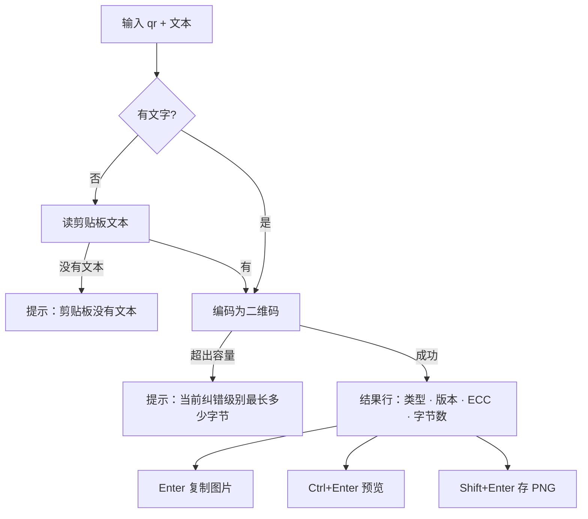

# ra9fael.qr — Win顺 二维码生成插件

把文字、链接或剪贴板内容变成二维码图：**Enter 复制图片、Ctrl+Enter 预览、Shift+Enter 存 PNG**。Wi-Fi 二维码请在 **ra9fael.wifi** 的 `wifi` 网络动作菜单中生成。

当前版本：**v0.2.1**。已删除 `qrwifi` 命令；本插件只负责文字、链接和剪贴板内容。

## 安装

- **插件库**：Win顺 → 设置 → 插件 → 插件库，搜索「二维码」安装
- **本地包**：从 [Releases](https://github.com/ra9fael/winshun-qr/releases) 下载 `.wsplugin`，在「已安装」里从压缩包安装
- **手动**：解包到 `%LOCALAPPDATA%\WinShun\plugins\ra9fael.qr\`（`plugin.json` 在目录根部），重启 Win顺

首次启用会征求权限：剪贴板读写、显示窗口、写入「图片」文件夹。需要 Win顺 **0.22.0** 及以上；打包、SHA-256 与构建复现见 [docs/release.md](docs/release.md)。

## 用法

### qr — 文字变二维码

输入 `qr` 空格进入命令，后面跟任意文字或链接；**直接回车（不输文字）用剪贴板内容**。结果行的副标题标注内容类型（URL / 文本）、二维码版本、纠错级别和字节数。

### 动作

| 按键 | 动作 | 说明 |
|---|---|---|
| `Enter` | 复制图片 | 二维码图片写入剪贴板，结果行副标题更新「已复制」 |
| `Ctrl+Enter` | 预览 | 置顶预览窗弹出后立即获取焦点，聚焦时 Esc / Ctrl+D / Ctrl+W 关闭 |
| `Shift+Enter` | 保存 PNG | 写入「图片」文件夹：`qr-日期-时间.png`，重名自动 +1 |
| `→` | 全部动作 | 菜单列出以上三个动作 + 复制文本 / 复制名称 |

### 设置

设置 → 插件 → 二维码：

| 设置 | 默认 | 说明 |
|---|---|---|
| 纠错级别 | M | L 约 7% 可恢复，M 15%，Q 25%，H 30%；级别越高码越密 |
| 模块像素 | 8 | 每个黑白格的边长，2–20 |
| 留白边距 | 4 | 四周留白为几个模块宽，0–8 |
| 深色 / 浅色 | `#000000` / `#ffffff` | 只影响渲染颜色，改了立即生效 |

## 隐私与权限

- 权限仅限：读剪贴板（空查询时）、写剪贴板、显示预览窗、写入「图片」文件夹
- 不联网、不起子进程、不提权、不持久化任何数据；不读取无线配置或 Wi-Fi 密码

## 文档

- 功能规格（设计依据与实测记录）：[docs/spec.md](docs/spec.md)
- 开发文档（架构、协议、构建）：[docs/dev.md](docs/dev.md)
- 测试规格与 E2E 清单：[docs/tests.md](docs/tests.md)
- 发布与安装流程：[docs/release.md](docs/release.md)
- 更新日志：[CHANGELOG.md](CHANGELOG.md)

English code/comments per project convention; user-facing strings follow the host locale (zh/en).

## License

MIT — see [LICENSE](LICENSE).

预览失焦后保留，内容区左键拖动、边框缩放、右键显示图片菜单；聚焦时 Esc、Ctrl+D、Ctrl+W 关闭，菜单打开时 Esc 先收起菜单。插件延迟启动，首次使用后常驻至宿主停止或禁用（`idleExitSec=0`）。发布与手动验证见 [WORKFLOWS.md](WORKFLOWS.md)。

鼠标滚轮同步缩放二维码和预览窗口，始终保留完整二维码与留白；恢复默认大小可回到初始尺寸。
