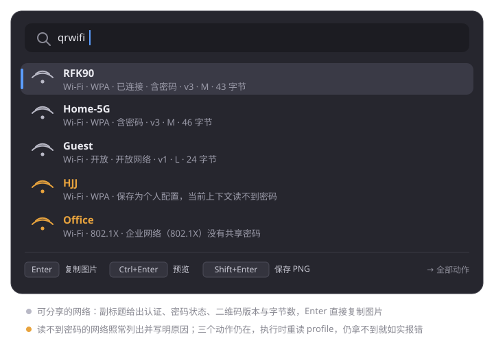
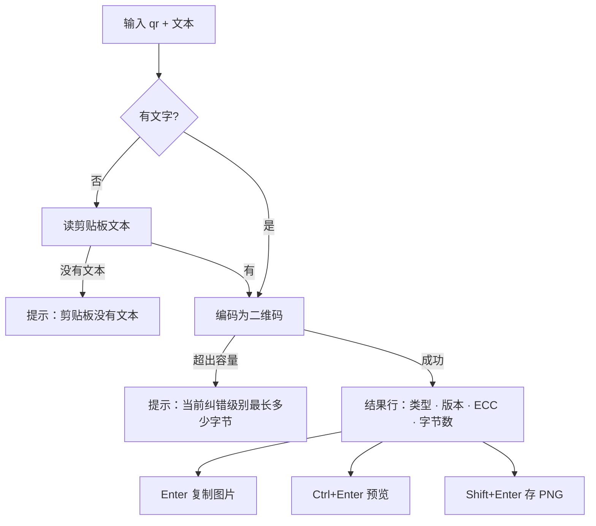
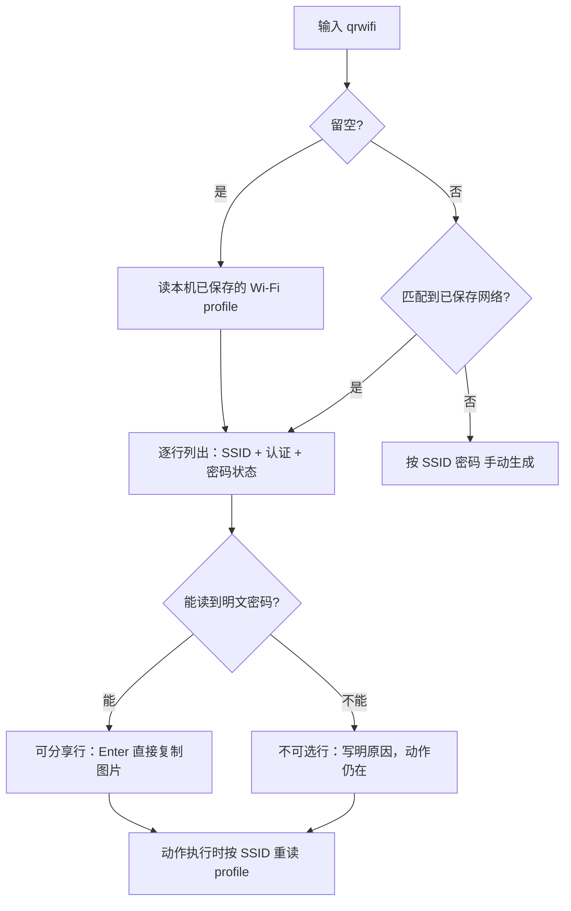
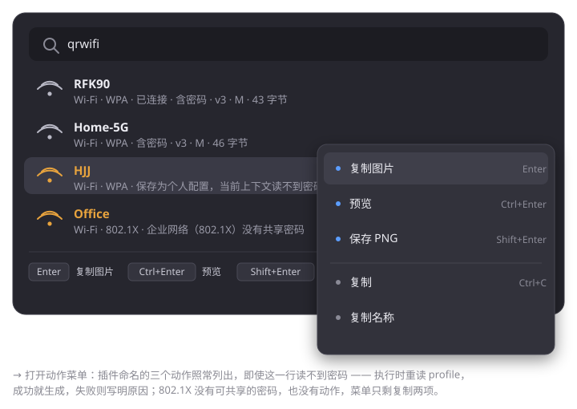

# ra9fael.qr — Win顺 二维码生成插件

把文字、链接或剪贴板内容变成二维码图：**Enter 复制图片、Ctrl+Enter 预览、Shift+Enter 存 PNG**；`qrwifi` 直接列出本机连接过的 Wi-Fi，生成手机扫码即连的二维码（也可 `qrwifi SSID 密码` 手动指定）。

状态：**已实现（v0.1.0）**。单测、OpenCV 解码交叉验证与协议往返实测通过；手机端 E2E 清单见 [docs/tests.md](docs/tests.md)。

## 安装

- **插件库**：Win顺 → 设置 → 插件 → 插件库，搜索「二维码」安装
- **本地包**：从 [Releases](https://github.com/ra9fael/winshun-qr/releases) 下载 `.wsplugin`，在「已安装」里从压缩包安装
- **手动**：解包到 `%LOCALAPPDATA%\WinShun\plugins\ra9fael.qr\`（`plugin.json` 在目录根部），重启 Win顺

首次启用会征求权限：剪贴板读写、显示窗口、写入「图片」文件夹。需要 Win顺 **0.22.0** 及以上；打包、SHA-256 与构建复现见 [docs/release.md](docs/release.md)。

## 用法

### qr — 文字变二维码

输入 `qr` 空格进入命令，后面跟任意文字或链接；**直接回车（不输文字）用剪贴板内容**。结果行的副标题标注内容类型（URL / 文本 / Wi-Fi 格式）、二维码版本、纠错级别和字节数。

### qrwifi — 连过的 Wi-Fi 扫码即连

输入 `qrwifi` 留空，列出本机**已保存**的 Wi-Fi（连接过一次就会出现在列表里）；继续输入按 SSID 筛选；输入的词匹配不到任何网络时，按 `SSID 密码` 手动形式处理（密码可空 = 开放网络）。

生成的二维码是标准的 `WIFI:T:…;S:…;P:…;;` 格式，iOS / Android 相机扫码后直接询问是否加入该网络。

### 动作

| 按键 | 动作 | 说明 |
|---|---|---|
| `Enter` | 复制图片 | 二维码图片写入剪贴板，结果行副标题更新「已复制」 |
| `Ctrl+Enter` | 预览 | 置顶预览窗（见下图），Esc 或点击窗外关闭 |
| `Shift+Enter` | 保存 PNG | 写入「图片」文件夹：`qr-日期-时间.png`，重名自动 +1 |
| `→` | 全部动作 | 菜单列出以上三个动作 + 复制文本 / 复制名称 |

### 设置

设置 → 插件 → 二维码：

| 设置 | 默认 | 说明 |
|---|---|---|
| 纠错级别 | M | L 约 7% 可恢复，M 15%，Q 25%，H 30%；级别越高码越密 |
| 模块像素 | 8 | 每个黑白格的边长，2–20 |
| 留白边距 | 4 | 四周留白为几个模块宽，0–8 |
| 深色 / 浅色 | `#000000` / `#ffffff` | 只影响渲染颜色，改了立即生效 |

## 读不到密码？三个原因

`qrwifi` 把**所有**已保存的网络都列出来——包括读不到密码的。这样的行显示为不可选（橙色），副标题写明原因，三个动作仍在：执行时会重读一次 profile（Win顺 此后可能以管理员运行、网络可能被重新保存），仍拿不到就如实报错，不会生成一张假码。

| 副标题 | 原因 | 能做什么 |
|---|---|---|
| 保存为个人配置，当前上下文读不到密码 | 该网络曾以管理员权限保存（Windows 把密码加密存放） | **以管理员身份运行 Win顺**再执行动作；或删掉网络重新连接一次 |
| 组策略管理此网络，密码不可共享 | 网络由公司/学校组策略下发，Windows 永远不给普通进程密码 | 联系管理员；或手动 `qrwifi SSID 密码` |
| 配置读取失败，无法生成 | 读取 profile 本身失败 | 重试；仍失败看 Win顺 的插件消息记录 |
| 企业网络（802.1X）没有共享密码 | 802.1X 认证没有本地保存的密码可分享 | 无法生成（此行没有动作） |

## 隐私与权限

- **密码不落盘**：结果行只带网络名，密码不进 Win顺 的结果列表；只在执行动作的那一刻按网络名重读一次，直接生成图片
- 权限仅限：读剪贴板（空查询时）、写剪贴板、显示预览窗、写入「图片」文件夹
- 不联网、不起子进程、不提权、不持久化任何数据；本插件所有读取都是本地配置

## 文档

- 功能规格（设计依据与实测记录）：[docs/spec.md](docs/spec.md)
- 开发文档（架构、协议、构建）：[docs/dev.md](docs/dev.md)
- 测试规格与 E2E 清单：[docs/tests.md](docs/tests.md)
- 发布与安装流程：[docs/release.md](docs/release.md)
- 更新日志：[CHANGELOG.md](CHANGELOG.md)

English code/comments per project convention; user-facing strings follow the host locale (zh/en).

## License

MIT — see [LICENSE](LICENSE).
