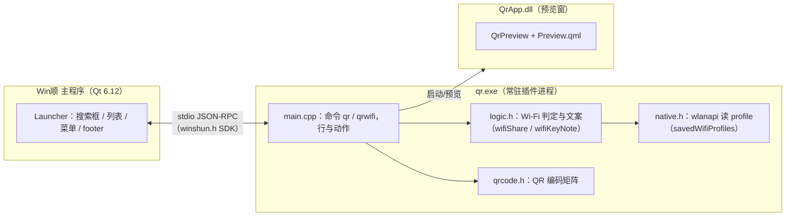
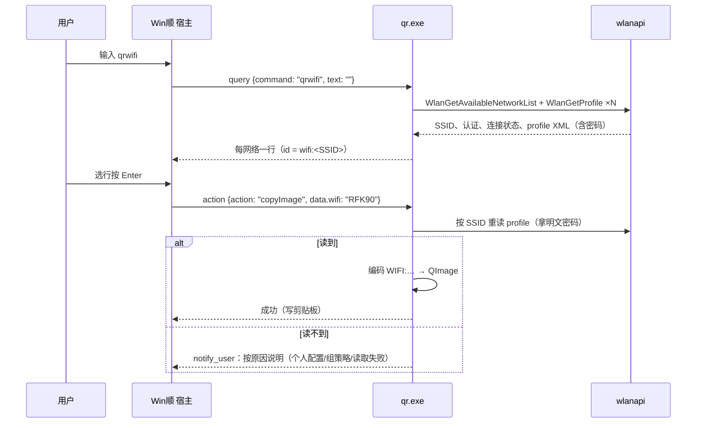
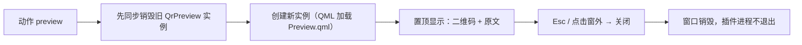
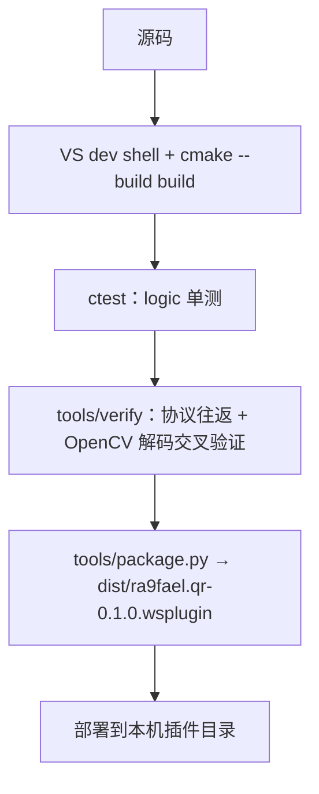

# ra9fael.qr 开发文档

面向想改这个插件、或照着写类似插件的人。用户视角的安装与用法在 [README](../README.md)，设计依据（为什么这么做、实测记录）在 [spec.md](spec.md)，宿主侧的插件协议见 [WinShun 插件文档](../../WinShun/docs/plugins.md)。

## 总览

一个 Win顺 **常驻插件**（C++，stdio 上的 JSON-RPC）：宿主每次按键把查询发过来，进程把结果行发回去。生成的二维码图不落盘——复制进剪贴板、预览到屏幕、或存成 PNG，由用户按键决定。



三个二进制，与 [bosskey 插件同构](../docs/release.md)：

| 文件 | 是什么 | 链接 |
|---|---|---|
| `qr.exe` | 常驻进程本体：协议、命令、编码；静态 CRT | CRT 静态 |
| `QrApp.dll` | QML 预览窗 | 宿主共享 Qt（`WS_QT_DIR`） |
| `stub/main.cpp` | 无 Qt 环境时的占位构建 | — |

## 仓库布局

```
plugin.json      清单：命令、权限、设置（minWinShun 0.22.0）
qr.exe / QrApp.dll   构建产物（打包时随 plugin.json 进 .wsplugin）
main.cpp         命令实现：查询 → 结果行；动作 → 生成图
logic.h          纯逻辑：Wi-Fi 分享判定、文案、id、payload（可单测，不碰 winapi）
native.h         wlanapi：WlanOpenHandle / GetAvailableNetworkList / GetProfile
qrcode.h         QR 编码（格式信息、掩码、对齐图形），与 ra9fael.bosskey 共用
qmlapp/          预览窗（QrPreview.cpp、qml/Preview.qml、qmlmain.cpp）
tests/           test_qr.cpp：logic 层单测（ctest）
tools/package.py 打 .wsplugin（zip）
tools/verify/    hostsim.py 协议往返、qr_check.py OpenCV 解码交叉验证、
                 probe_profiles.cpp out-flags 探针
```

## 一次查询的生命周期



要点：

- **密码不进 item**。列表行只带 SSID（`data.wifi`），动作执行时再读一次。密码不落在宿主的结果列表里，也不会因列表刷新变陈旧。
- **行 id 按 SSID 唯一**（`wifi:<SSID>`）。宿主合并结果时对重复 id 只保留第一行（Merge.cpp），这是"三个网络只显示一个"的根因，见 [spec.md §3](spec.md)。
- **读不到的网络也列出**（`valid:false` + 原因副标题），且保留三个动作——宿主对有名动作不设 valid 门控（→ 菜单 / footer / 动作分发都放行，WinShun 0.22.0 起）；802.1X 没有可共享密码，行不带动作。

## Wi-Fi 密码为什么有时读不到

`WlanGetProfile` 带 `WLAN_PROFILE_GET_PLAINTEXT_KEY` 时，profile 的 out-flags 决定明文是否可得（`tools/verify/probe_profiles.cpp` 实测，2026-11-08）：

| out-flags | 含义 | 明文 |
|---|---|---|
| `0x0`（无标志） | all-user 配置（wlanapi.h 没有 ALL_USER 常量，"无标志"就是它） | 普通进程可读 |
| `WLAN_PROFILE_USER`（0x2） | per-user 个人配置（常因曾以管理员保存） | 受保护 blob，读不到 |
| `WLAN_PROFILE_GROUP_POLICY`（0x1） | 组策略下发 | 永远读不到 |

`logic.h` 把三种情况折成一个 `WifiShare` 判定（`Ready / Open / NeedsKey / Enterprise`）+ `wifiKeyNote()` 文案；`main.cpp` 只负责把它变成行和动作。改判定或文案只动 `logic.h`，单测在 [tests/test_qr.cpp](../tests/test_qr.cpp)。

## 预览窗



先销毁再创建不是洁癖：QML 引擎持着旧实例的 HWND 上下文，二次打开会冲突崩溃（bosskey 时代踩过的坑，`QrPreview.cpp` 注释里有）。预览窗底色恒为浅色（`lightColor`），深色主题下不反转，保证扫码对比度。

## 构建与验证



构建必须在与 cmake 同一条命令链里先进 VS dev shell（否则连 `<string>` 都找不到）：

```powershell
& "C:\Program Files\Microsoft Visual Studio\18\Community\Common7\Tools\Launch-VsDevShell.ps1" -Arch amd64 -SkipAutomaticLocation
cmake --build build --config Debug
ctest --test-dir build -C Debug --output-on-failure
```

验证工具（都在 `tools/verify/`）：

- `hostsim.py`：不启动宿主，模拟它的协议往返（含对重复 id 的防回归检查）
- `qr_check.py`：生成 PNG 后用 OpenCV 解码回原文，交叉验证编码器
- `probe_profiles.cpp`：打印本机每个 profile 的 out-flags 与明文可得性（`cl /EHsc /W3 probe_profiles.cpp wlanapi.lib`）

## 打包与发版

1. 改完代码：`plugin.json` 升 `version`，[CHANGELOG](../CHANGELOG.md) 记一笔（有 CHANGELOG 才会生成 release notes）
2. `python tools/package.py`：产 `dist/ra9fael.qr-<版本>.wsplugin`（zip：`plugin.json` + 两个二进制 + README + LICENSE）和 `dist/release-notes.md`
3. 部署本地试：把 `qr.exe`、`QrApp.dll` 复制到 `%LOCALAPPDATA%\WinShun\plugins\ra9fael.qr\`，停用再启用插件
4. 发布流程（tag、GitHub Release、SHA-256）见 [release.md](release.md)

## 约定

- 代码与注释英文；用户可见字符串中英双语（`zh ? "…" : "…"`），跟随宿主 locale
- 提交信息中文单行；纯逻辑放 `logic.h` 保持可单测，winapi 调用只在 `native.h`
- 权限最小化：不声明 `network` / `elevated`（见 [spec.md §6](spec.md)——共享 Qt 与 elevated 首版不能同用）
